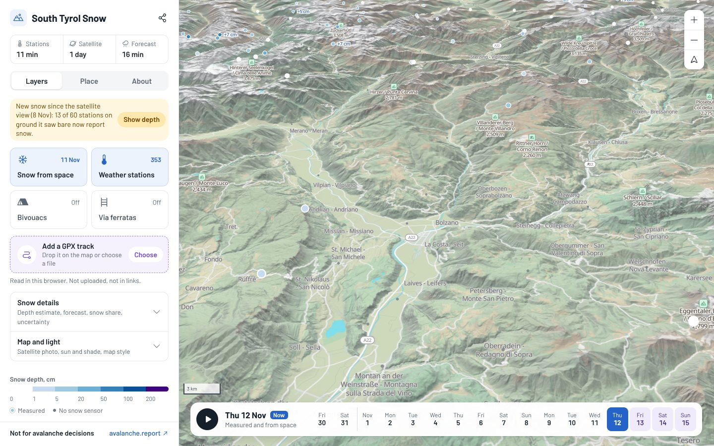

# South Tyrol Snow Map

Where is there snow in South Tyrol right now, and where will there be? A 3D map of the region that puts weather station readings, satellite snow cover and the snowfall forecast on the real terrain, in the browser, with no account and no app to install.

**Open it: <https://adamvalik.github.io/tirol-snow-map/>** (data updated three times a day)

[](https://adamvalik.github.io/tirol-snow-map/)

> **Not for avalanche decisions.** This is a visualisation for orientation only. Always check the official bulletin at [avalanche.report](https://avalanche.report).

## What you can do

- **See where the snow is**: snow seen by Sentinel-2 at about 60 m, readings from about 350 weather stations across the Euregio (snow depth and its 24/48/72 h change, temperature, wind), and an estimated snow depth for every 250 m of terrain, with how far to trust it.
- **Scroll through time**: one timeline from 14 days back to 3 days ahead, with an animated snowfall forecast on the terrain.
- **Check a place**: tap anywhere for the snow there, a 7-day forecast for that elevation, when the sun rises and sets behind the real skyline, and which avalanche warning region it is in, with a link to that region's bulletin.
- **Find yourself**: the location button shows where you are on the map. Your position stays on your device.
- **Check a route**: load a GPX track to see its distance, climb, highest point and how much of it lies on snow. The file stays in your browser.
- **Plan a tour**: bivouacs and via ferratas (A–E grades, snow along the route), sun and shade with cast shadows for any day and time, a true-colour satellite photo.
- **Share the view**: the link always holds what is on the screen, from camera angle to layers and day.

It works on phones and desktop browsers. Something wrong or an idea? Use *Something is wrong* or *Idea* in the app's About tab, or [open an issue](https://github.com/adamvalik/tirol-snow-map/issues/new/choose).

## Status

**[v0.2.0](https://github.com/adamvalik/tirol-snow-map/releases/tag/v0.2.0)** (Nov 12, 2026): the first release for testers, with the new interface, GPX tracks, the Euregio station feeds and the snow depth change at stations. See [Releases](https://github.com/adamvalik/tirol-snow-map/releases) for what changed in each version.

What comes next: [`docs/release-plan.md`](docs/release-plan.md) (the tester release and what follows it) and [`docs/roadmap.md`](docs/roadmap.md) (the longer view). The original build plan is [`plan.md`](plan.md) and the spike findings are in [`docs/spike-report.md`](docs/spike-report.md).

The rest of this README is for developers: how to run it, how the data flows, and its known limits.

## Run it locally

Requires Node 22+.

```sh
npm ci
npm run basemap             # one-off, ~1-2 min: OSM extract -> web/public/basemap/south-tyrol.pmtiles (~90 MB, not in git)
npm run pipeline            # stations, snow layers, history, satellite picture, forecast -> web/public/data/
                            # needs CDSE_USERNAME / CDSE_PASSWORD (snow cover) and CDSE_CLIENT_ID / CDSE_CLIENT_SECRET (picture)
                            # caches it keeps between runs go to data/state/ (not published)
# or: npm run pipeline:fixtures   (offline, from the saved fixtures)
npm run dev                 # http://localhost:5173
```

Other scripts:

| Command | What it does |
| --- | --- |
| `npm test` | Unit tests (parsers, merge, PMTiles extractor, web helpers) against `fixtures/` |
| `npm run dem` | Rebuild `pipeline/assets/dem-grid.bin`, the 250 m elevation grid the snow model uses (static; only when the grid changes) |
| `npm run basemap` | Re-cut the OSM basemap from the newest Protomaps daily build (monthly is plenty) |
| `npm run bivouacs` | Refresh `web/src/data/bivouacs.json` from OpenStreetMap via the Overpass API (static; `OVERPASS_URL` picks another Overpass instance when the main one is busy) |
| `npm run ferratas` | Refresh `web/src/data/ferratas.json`, the via ferrata layer, from OpenStreetMap via the Overpass API, with length, elevation range and climb from Mapterhorn terrain tiles (static; `npm run ferratas -- saved.json` reads a saved Overpass response when every instance is busy) |
| `npm run regions` | Refresh `web/src/data/regions.json`, the avalanche warning regions, from [regions.avalanches.org](https://regions.avalanches.org) (EAWS, CC0): the regions valid now that touch the data area, simplified to about 30 m, with English and local names and each warning service's bulletin page (static; the regions change rarely, so once before a winter is plenty) |
| `npm run basemap:assets` | Re-download the fonts and icon sprites the basemap style needs (committed in `web/public/basemap-assets/`) |
| `npm run typecheck` | TypeScript check of app, pipeline and tests |
| `npm run build` | Typecheck and production build into `dist/` (includes whatever is in `web/public/data`) |
| `node scripts/og-image.mjs` | After `build`: renders the link preview picture `dist/og.jpg` (see Deployment). Set `CHROMIUM_PATH` if Playwright's browser is not installed |
| `npm run smoke` | After `build`: opens the built app in Chromium (desktop and phone profiles) and reports load time, console errors, whether the station and forecast panels work, and on desktop the timeline (a past day, forecast playback), via ferratas and a shared link. Set `CHROMIUM_PATH` if Playwright's browser is not installed |

## How data flows

```text
Province meteo API v1 (CC0) ----+
                                +--> pipeline (Node, scheduled) --> web/public/data/stations.json --> browser
Euregio station feed (linea) ---+     parse, convert units,              (static file)               |
Copernicus snow cover 500 m ----+     drop stale, merge duplicates,  --> snow.json + snow-*.png -------->+
  (CDSE login, daily)           |     snow depth model on 250 m grid --> history.json + history/<day>/ -->+
Sentinel-2 L2A (Sentinel Hub) --+     newest clear day -> tiles      --> satellite.json + satellite/ ---->+
Open-Meteo grid (every 6 h) ----+     snowfall on the terrain        --> forecast.json + forecast/ ------>+
                                      depth model error per day      --> model-error.json -------------->+
                                      health of each step, quota use --> status.json ------------------->+
Protomaps OSM build --> npm run basemap --> web/public/basemap/south-tyrol.pmtiles ------------------>+  (same site, range requests)
Mapterhorn terrain tiles --------------------------------------------------------------------------->+  (direct)
Open-Meteo forecast (on click) --------------------------------------------------------------------->+  (direct, cached 1 h)
```

- **The browser calls only two external hosts**: `tiles.mapterhorn.com` for terrain and `api.open-meteo.com` for click forecasts. Everything else comes from files the pipeline generated. The smoke test checks this. The one exception is visit counting on the live site, when `GOATCOUNTER_CODE` is set (see Deployment).
- **Where am I** (`web/src/app/locate.ts`): MapLibre's geolocate control behind the round location button: a blue dot with the accuracy circle, and the map follows until it is panned (a tap brings it back, another switches it off). The browser asks for permission only when the button is tapped, and the position is not in share links, analytics or any request. Outside the data area a toast says so; farther than the map can pan, the control stops. MapLibre 6 has no heading arrow.
- **Avalanche region of a place** (`web/src/regions.ts`, `pipeline/src/regions.ts`): the place panel's bulletin row names the EAWS micro-region of the point (for example "Schnals Ridge (Schnalser Kamm / Cresta di Senales), IT-32-BZ-03") and links to the service that publishes its bulletin: avalanche.report for Tirol, South Tyrol and Trentino, and the neighbours' own pages (AINEVA, SLF, Salzburg, Carinthia, Livigno) at the edges. avalanche.report has no link to a single region, so the row names it for finding it on the bulletin map. The outlines (`web/src/data/regions.json`, about 60 KB compressed) are fetched from the site the first time a panel opens. Only a link: the app never shows or judges danger levels.
- **Feedback and visit counts** (`web/src/app/feedback.ts`, `web/src/app/analytics.ts`): The About tab starts with *Something is wrong* and *Idea*. They open an e-mail to `FEEDBACK_EMAIL` with the app version, the current view link, the browser and the screen size filled in, and offer the GitHub issue forms (`.github/ISSUE_TEMPLATE/`), prefilled the same way, for testers with an account. Visits are counted with GoatCounter as a plain image request to its counting endpoint (no script, no cookies), never on localhost or in automated browsers. A page view is counted as `/` with the app version as its title, so testers on an old cached copy show up; the hash with the view is never sent. Events, each at most once per page load: `layer/<key>` when a person switches a layer on, `share`, `about`, `feedback/<bug|idea>-<mail|github>`.
- **Pipeline** (`pipeline/src/run.ts`):
  - Fetches both station sources, converts units (m → cm, K → °C, m/s → km/h) and drops readings older than 24 h.
  - Merges records that describe the same station (within 300 m and 60 m of elevation, from different providers). The freshest record wins, and the province API wins ties.
  - Keeps the change in snow depth over 24, 48 and 72 h from the Euregio feed (`HSD_24`, `HSD_48`, `HSD_72`), shown in the station panel and tooltip. The province API has no such field, so a provincial station gets it from the feed's avalanche-service copy of the same station when the two merge (on 2026-10-20: 186 of the 196 snow stations on the map had it). A change is dropped when the station has no valid depth, when it exceeds 250 cm, or when it is a larger gain than the depth now.
  - Writes `stations.json` with per-source status, licence and fetch time.
  - If every source fails, it keeps the previous file and marks it `stale`; the app then shows a warning.
- **Basemap** (`pipeline/src/basemap/`): the Protomaps daily planet build is read with HTTP range requests, and only the tiles for South Tyrol are written into a new PMTiles file. Zooms 0–9 cover the whole pannable area, zooms 10–14 South Tyrol. A small built-in writer is used because the `pmtiles` npm package only reads. The style comes from `@protomaps/basemaps` (light flavour), drawn translucently over the terrain tint and under the hillshade.
- **Snow seen from space** (`pipeline/src/snow/s2cover.ts`, `pipeline/src/sources/sentinel2Snow.ts`, the default snow view): every Sentinel-2 pass day of the last 10 days with some clear sky is classified per pixel on a 3056 × 2048 grid (about 60 m) by the Process API: snow where NDSI = (B03 − B11)/(B03 + B11) > 0.4 on bright ground (relaxed in terrain shadow) or where the scene classification says snow; clouds from the scene classification, except pixels that look like snow and not cloud in the shortwave infrared; everything else bare. Each pixel takes its newest clear view. The app draws snow pixels white under the hillshade (older views fainter); cloud-hidden pixels stay unpainted. Classified days are cached in `data/state/s2-snow/`, so each pass day costs processing units once (about 30–40 PU). The same composite, summed into the 250 m cells, is the snow cover that masks the depth estimate (views up to 6 days old, counted to today). When at least 3 stations stand on cells a view saw bare and a fifth of them now report 5 cm of snow or more, snow has fallen since: that view and older ones stop masking, so a snowfall under clouds is not wiped out by the last clear pass; the Copernicus 500 m product is only a fallback when Sentinel-2 is unavailable.
- **Snow layers** (`pipeline/src/snow/`, run as part of `npm run pipeline`):
  - **Snow cover**: the Copernicus *Snow Cover Extent Europe 500 m* products (VIIRS and MODIS, one each per day) of the last four days are found in the open CDSE catalogue, downloaded with the account in `CDSE_USERNAME` / `CDSE_PASSWORD` (each is a ZIP around a COG), and decoded onto the grid: codes 100–200 are 0–100 % snow; 255, the GeoTIFF no-data value, is used for clouds and gaps (code 30 from the manual never occurs in these files). Each cell takes its newest clear view ("last clear view" composite). Views up to a day old mask the depth estimate; older ones are drawn fainter and only shown. The composite is cached and rebuilt only when a new product appears (about twice a day).
  - **Estimated snow depth** follows `plan.md`: a least-squares elevation trend fitted to all stations with a snow reading, plus station residuals spread by inverse distance weighting that fade back to the trend about 12 km from a station. Cells the satellite sees as snow-free (under 15 %) are set to 0. Leave-one-out validation (hide each station, predict it from the rest) runs on every update and picks trend-only or trend-plus-residuals, whichever predicts better; its mean absolute error is shown in the app, overall and per elevation band.
  - **Confidence** per cell: high within 10 km of a snow station and inside the stations' elevation range; medium within 25 km and 300 m of the range; low otherwise; one level lower where the satellite has no view (cloud or no data).
  - **Outputs**: `snow.json` (dates, method, trend, validation, snow line), `snow-cover.png`, `snow-depth.png`, `snow-confidence.png`, and `snow-data.png`, which stores depth and cover losslessly in its colour channels so the app can show the value under a click.
  - The grid (`shared/grid.ts`) has 764 × 512 cells of about 250 m, with rows spaced evenly in Web Mercator so the PNGs line up exactly on the map.
- **Satellite picture** (`pipeline/src/satellite/`, `pipeline/src/sources/sentinel2.ts`): the Sentinel Hub catalogue lists Sentinel-2 L2A passes of the last 20 days; each day is scored by how much of the region it shows cloud-free. The newest day above 45 % is rendered in true colour through the Process API (clouds and cirrus made transparent with the scene classification band, snow stays white), and the newest older day above 35 % fills the cloud gaps. Zoom 12 (about 25 m pixels) is rendered in 2048 px chunks and cut into 256 px WebP tiles; zooms 8–11 are built locally. Process API requests are retried on rate limits, server errors, dropped connections and timeouts. Rendering happens only when the chosen days change, because it costs Copernicus processing units (roughly 300–700 per refresh; check usage in the CDSE dashboard). Output: `satellite.json` (dates, shares) and `satellite/{z}/{x}/{y}.webp` (about 11 MB).
- **Day slider** (`pipeline/src/history.ts`): after each run the snow layers, `snow.json` and `stations.json` are copied to `history/<day>/` (local South Tyrol day; the day's last run wins) and listed in `history.json`, newest first, for 14 days. When the history starts, earlier Sentinel-2 pass days still in the cache are rebuilt as snow-cover-only days (no depth estimate, no station readings), so the slider is not empty on day one. The app swaps the snow pictures, the click readout and the station dots to the chosen day.
- **Sun and shade** (`web/src/sun.ts`, in the browser only): the **Sun and shade** switch lights the hillshade from where the sun stands at a chosen date and time of day, so slopes facing the sun are bright and slopes turned away stay dark, which shows which slopes keep their snow. The sun position comes from [SunCalc](https://github.com/mourner/suncalc) 2.x (degrees, azimuth clockwise from north, which MapLibre's illumination direction takes as is) for the map centre. The light is fixed to the map (`hillshade-illumination-anchor: map`) and uses the `basic` hillshade method, because the default `standard` method ignores the sun's altitude. Low sun is warm; once the sun is below the horizon the light fades, a dark overlay deepens through twilight and the sky darkens. The sun row of the timeline has a time slider (local Europe/Rome day, 23 or 25 hours on clock-change days), a date field, jumps to sunrise, now and sunset, and a play button that runs from just before sunrise to just after sunset. The approach comes from the spike in `docs/sun-shade-spike.md` (tier 1 of 3).
- **Sun at a clicked point** (`shared/horizon.ts`, `web/src/terrainSampler.ts`, `web/src/sunHere.ts`, tier 2): the point panel traces the skyline seen from the point (2 m eye height) in 360 one-degree rays. The first 5 km come from Mapterhorn z11 tiles (about 26 m pixels, fetched on the click), where nearby ridges decide when a valley gets the sun; from there to 100 km the committed 250 m grid (`pipeline/assets/dem-grid.bin`, loaded once, 782 KB) is used, with the earth's curvature and standard refraction. The day is scanned every 2 minutes and each crossing refined to a second; the sun counts as visible while its top edge is above the skyline. The panel shows first and last sun (with the flat-horizon times beside them), the ridge each happens over, sunshine hours, any gaps, and a chart of the skyline with the sun's path and the slider time. With **Sun and shade** on it runs on every click; otherwise the panel offers a button. Tracing takes about 0.2 s once the tiles are cached, a second or more on a cold start.
- **Cast shadows** (`shared/shadow.ts`, `web/src/shadows.ts`, `web/src/shadowWorker.ts`, tier 3): with **Sun and shade** on, the **Cast shadows** switch (on by default) darkens sun-facing slopes that a ridge hides from the sun, on the 250 m grid. One sweep from the sun's side of the grid carries a running shadow height from cell to cell (a few operations per cell instead of a ray per cell), so a new sun position takes about 15–50 ms in a Web Worker and the play button animates the shadows with the day. The sun's direction is the map centre's; its altitude comes from a 9 × 6 lattice over the region, since a low sun stands about a degree higher in the east than in the west. Slopes turned away from the sun are left to the hillshade. The grid is downloaded the first time shadows are shown (the same file the point panel uses). A cross-check in the tests compares the sweep with the horizon traced cell by cell: 99.6 % of the sampled cells agree.
- **Forecast snowfall** (`pipeline/src/forecast/`): one multi-location Open-Meteo request (best-match blend) for hourly precipitation and freezing level at 273 points about 10 km apart, at most every 6 hours (each point counts as one call against the free limit, and runner IPs are shared). Both fields are interpolated to the 250 m cells, and the terrain decides how much falls as snow: all of it more than 150 m above the snowfall limit (300 m below the freezing level), none more than 150 m below, 1 cm of snow per mm of water. Every run re-renders the accumulated new snow every 3 hours for the next 72 hours as `forecast/fNN.png`, so the animation starts at the current hour. The model's own snowfall is not used: it belongs to the model's smooth terrain, which misses the snow line. If Open-Meteo fails, the last grid is reused while it reaches at least 12 hours ahead, flagged stale.
- **Health** (`pipeline/src/status.ts`): `status.json` lists each step's problems (an unreachable upstream, an exception; not "no clear pass", which is weather) and how many runs in a row it has failed. The app turns it into warnings; the deploy workflow into an issue. When the Sentinel-2 catalogue is unreachable, the snow map is built from the cached pass days instead.
- **Upstream quotas** (`pipeline/src/usage.ts`): every Sentinel Hub answer is counted, with the processing units it reports in its `x-processingunits-spent` header, and every Open-Meteo forecast fetch counts one call per point (273). `status.json` keeps the month's totals (`usage`, reset on the 1st, UTC) against the free allowances: 10,000 processing units and 10,000 requests a month on a CDSE "Copernicus General" account, and 10,000 calls a day and 300,000 a month on Open-Meteo. The run log prints them, and `scripts/monitor.mjs` opens an issue labelled `upstream-budget` when any passes 80 %, closed again when usage drops below (normally in the new month). Only production runs count: the check workflow's use is not added, so the CDSE dashboard stays the final word.
- **Model error over time** (`pipeline/src/history.ts`): `model-error.json` keeps each day's leave-one-out error of the depth estimate (the day's last run wins): the method chosen, its mean error, both methods' errors, the station count and the error per elevation band, for 400 days, so a winter shows whether the estimate holds. It is published with the data (`data/model-error.json` on the site) but not shown in the app yet.
- **Check workflow** (`.github/workflows/snow-check.yml`): runs the tests and the live pipeline with the repository secrets, prints `snow.json`, and uploads the outputs as a workflow artifact. It starts from production's latest data (the deploy's Actions cache, read only), so the satellite picture and the Sentinel-2 snow days are rendered again only when a newer clear day has appeared; run it by hand with **fresh** to render everything from scratch. It runs by hand or on pushes to `claude/**` branches.
- **Pull request checks** (`.github/workflows/ci.yml`): tests, typecheck, build and the browser smoke test (`scripts/smoke.mjs`) on every pull request, offline on the fixture data, with the basemap from production's cache when there is one. The smoke screenshots are uploaded as an artifact. Load time is printed but only gated at 90 s there (`SMOKE_READY_LIMIT_MS`), since runners render WebGL in software; locally the limit stays 5 s.
- **Production workflow** (`.github/workflows/deploy.yml`): see [Deployment](#deployment).
- **Data contract**: `shared/types.ts`.
- **Sources**:
  - Province API v1: `geoservices.buergernetz.bz.it/services/meteo/v1`. Official, CC0, about 97 stations, 26 of them with snow depth.
  - Euregio station feed: `static.avalanche.report/eaws_weather_stations/linea.geojson`, the feed behind avalanche.report. It covers Tirol, South Tyrol, Trentino and neighbouring stations, and about 270 within the region box report snow depth. Licence is per operator; LWD Tirol, GeoSphere, ARPAV and SLF data are CC BY 4.0.
  - Within South Tyrol, both sources carry the same provincial stations; the pipeline merges these duplicates.

## Repository layout

| Path | Contents |
| --- | --- |
| `web/` | Vite + TypeScript + MapLibre GL JS app (no UI framework), laid out after the C2 design; `web/src/theme.css` holds the app font (change it there only) and the colours; `web/public/basemap-assets/` holds the map's self-hosted fonts and sprites |
| `pipeline/` | Data fetch and normalisation (run with `tsx`) and its tests |
| `shared/` | Types shared by the pipeline and the app |
| `fixtures/` | Real API responses from 2026-10-20 used by the tests (see `fixtures/README.md`) |
| `scripts/smoke.mjs` | Browser smoke test |
| `scripts/monitor.mjs` | Opens and closes the `data-pipeline` issue from `status.json` (run by the deploy workflow) |
| `docs/` | Release plan, roadmap, design notes (share snapshot) and spike reports |

## Shareable view

The address bar always holds the current view, for example `#map=10.40/46.4700/11.3540/20/60&x=1.5&layers=snow,stations,sun&day=2026-10-18&f=5&sun=2026-10-21T06:30Z`: zoom/latitude/longitude/bearing/pitch, vertical exaggeration, the layers switched on, the slider day (left out for the latest data), the forecast frame and, with the sun light on, its time as a UTC minute. The link button next to the title copies it (phones get the share sheet). Invalid parts fall back to the defaults, and a day that has left the 14-day window opens the latest data.

## Deployment

`.github/workflows/deploy.yml` runs three times a day, early in the morning, after lunch and in the evening (03:47, 11:47 and 17:47 UTC, so 04:47, 12:47 and 18:47 in South Tyrol in winter, an hour later in summer; the evening run usually has the same day's Sentinel-2 pass), on every push to `main` and by hand. It restores the previous run's data from an Actions cache, runs the pipeline, saves the data again, builds the app with the data inside, renders the link preview picture and publishes it to GitHub Pages. The basemap is rebuilt once a month and cached. Only the three newest data caches are kept.

A failed upstream never stops a deploy: the files keep the last good data, the app shows a warning, and `scripts/monitor.mjs` opens an issue labelled `data-pipeline` when a step has failed three runs in a row (about a day) or the pipeline crashed. The issue is updated while it keeps failing and closed automatically when everything works again, so watching the repository is the alert.

One-time setup:

1. Scheduled workflows only run on the default branch, so the workflow must be on `main`.
2. Settings → Pages → Build and deployment → Source: **GitHub Actions**.
3. Settings → Secrets and variables → Actions: `CDSE_USERNAME`, `CDSE_PASSWORD`, `CDSE_CLIENT_ID`, `CDSE_CLIENT_SECRET` (already set if the check workflow works).
4. Run "Update data and deploy" once from the Actions tab. The first run takes a few minutes longer (basemap, satellite tiles, classifying the Sentinel-2 days). The site appears at `https://<user>.github.io/tirol-snow-map/`.
5. Optional, Settings → Secrets and variables → Actions → **Variables**: `SITE_URL` (the site's full address, only once a custom domain is set; the link preview tags need an absolute address and default to `https://adamvalik.github.io/tirol-snow-map/`), `FEEDBACK_EMAIL` (the address the app's "Something is wrong" and "Idea" links write to; without it they go to GitHub issues only) and `GOATCOUNTER_CODE` (the site code from a free [GoatCounter](https://www.goatcounter.com) account, the part before `.goatcounter.com`; without it nothing is counted). Both end up in the public page, so use an address you are happy to have there. They take effect with the next deploy.

**Link preview.** A shared link is a hash, which servers never see, so every link previews the same way in WhatsApp, Signal and the like: the `og:` and `twitter:` tags in `web/index.html` (filled with the site address by `vite.config.ts`) and `og.jpg`, 1200 × 630, which `scripts/og-image.mjs` renders after each build from the default view with the panels hidden and a card with the name and the day of the data. It is a JPEG kept under 280 KB, because WhatsApp drops larger pictures, and its address carries the build date so chat apps do not show yesterday's from their cache. If rendering fails, the deploy keeps the live site's picture. Try it locally with `npm run build && node scripts/og-image.mjs --out og.jpg`.

**Keeping the schedule alive.** GitHub switches scheduled workflows off in a public repository after 60 days without commits, and the data deploys are not commits. The `keep-schedule` job re-enables the workflow through the API on every scheduled run, which restarts that count, and opens an issue if the last commit is 50 days old anyway. Scheduled runs can also start late when GitHub is busy; the station warning in the app ("out of date") shows when data stops arriving, and the workflow can be re-enabled from the Actions tab.

## Known limits

- **The map ends at the data.** The data area is the 250 m snow grid (10.2–12.7° E, 46.1–47.25° N, `web/src/island.ts`). By default the world outside is faded under a pale veil; the **Cut at the data edge** switch (kept in share links as `island`) cuts the elevation tiles in the browser instead, so the terrain stops in a cliff on a plain floor and tiles outside are not downloaded. Either way labels, stations, bivouacs and via ferratas outside are hidden (a via ferrata counts as inside when it starts inside) and clicks there do nothing. Innsbruck and Trento lie just outside. Stations outside still feed the snow depth model.
- **No snow-depth sensors in the valleys.** Inside South Tyrol, snow depth is measured only at about 1700–3000 m; the lowest station in the surrounding region is at about 530 m. A missing marker does not mean there is no snow.
- **The snow depth map is an estimate, not a measurement.** It is a smooth trend with local corrections; real depth varies far more (wind drift, sun-exposed slopes, gullies). The leave-one-out error in the app tells you how far off a station-like spot typically is. Above about 3000 m, and in valleys below the lowest station, it extrapolates.
- **The satellite picture is a few days old at best** (Sentinel-2 passes every 2–5 days, clouds permitting) and 25 m per pixel; it is not a live webcam. Where both days were cloudy the map shows through.
- **Snow from space needs clear sky.** A pixel shows its newest clear view in the last 10 days, so snow that fell after that view is missing until the next clear pass, and pixels hidden by clouds on every pass show no snow. Dark, shaded slopes and thin early-season snow can be missed; bright cloud over snow can be confused with it.
- **The Copernicus fallback is 500 m and optical.** Clouds hide the ground: cells are filled from up to three earlier days (fainter) and hatched if never seen. Narrow valleys and thin early-season snow (under 15 % of a 500 m cell) can be missed, and a day's product appears in the afternoon (VIIRS) or evening (MODIS).
- **Station snow depth is a point measurement.** Wind and terrain make real depth vary a lot over short distances.
- **The depth change is not snowfall.** It is new snow minus settling and melt, so after a storm it is usually less than what fell, and wind can blow snow onto or off a sensor. A few stations (some Swiss and Austrian ones, a couple in South Tyrol) do not report it.
- **The forecast is model output** (Open-Meteo, best-match blend), downscaled to the clicked elevation. Open-Meteo's own model snow depth is not used: in the spike it read 0 cm where a station measured 5.8 cm.
- **Open-Meteo rate limits are per IP**, with a free non-commercial tier. Normal use is far below them. A shared IP (CI, some networks) can hit them, and the panel then shows the error.
- **Terrain download is heavy.** The first view loads about 50 DEM tiles (about 8 MB, cached by the browser for 7 days). On phones the 3D mesh uses coarser tiles and a capped pixel ratio.
- **Basemap** is a snapshot of OpenStreetMap, refreshed only when `npm run basemap` runs. Zoom 15 is left out to keep the file under 100 MB; closer views over-zoom zoom-14 tiles. Building heights are estimates where OSM has none.
- **Bivouacs** are a static OpenStreetMap list (`web/src/data/bivouacs.json`, ODbL), refreshed only when `npm run bivouacs` runs. It holds the huts and shelters inside the station box whose name says bivacco, Biwak, bivak or bivouac (unnamed or differently named emergency huts are missed), without the ones marked private or disused. Red cabins are metal boxes, brown ones wooden; OSM rarely records the material, so a hut is drawn wooden only when `building:material=wood` or its description says it is built of wood, and most are drawn red. Whether a bivouac is open, equipped or still standing is not checked. From zoom 13 the icons give way to small 3D cabins standing on the terrain (`web/src/cabins.ts`): a half-barrel or a gabled hut with a door, turned a fixed but different way for each bivouac (OSM does not record which way they face) and drawn 8 times life size, since a real bivouac of about 3 m would be a single pixel. On steep slopes the uphill side sits slightly in the ground. Clicking one opens the point forecast at its surveyed elevation. The heart in that panel marks a bivouac as a favourite (visited or planned): it gets a red heart on the map, and the **Only favourites** switch hides the rest. Favourites are kept in the browser's localStorage (`web/src/favourites.ts`), so they stay on that device and browser and are lost if its site data is cleared; the switch, not the list, travels in a shared link.
- **Via ferratas** are a static OpenStreetMap layer (`web/src/data/ferratas.json`, ODbL), refreshed only when `npm run ferratas` runs, and fetched by the app the first time the layer is switched on (about 125 KB compressed). It holds every way tagged `highway=via_ferrata` or `highway=path` with a `via_ferrata_scale` in the station box, plus `route=via_ferrata` relations; a relation made only of plain paths is drawn from those paths, and a relation's approach paths are left out. OSM maps most routes as chains of short ways without a relation, so `pipeline/src/ferratas.ts` joins ways that touch, share a relation, or carry the same name within 150 m into one route (2026-10-21: 1010 ways into 458 routes, 413 graded, 300 named, 9 closed). Names alone never split a route, because variants, rope bridges and descents are often named separately; the cost is that ferratas that really connect (the Bocchette, the Paternkofel tunnels) show as one route system, with the other names listed in the panel. A route takes its hardest section's grade on the OSM scale 0–6, shown as the A–E letters guidebooks use (1–5 are A–E, 0 counts as A and 6 as E, and a plus or minus becomes the in-between grade: `3+` is C/D, `3-` B/C); the panel adds the French and Italian grades from the OSM wiki. Colour and line width both rise with the grade; ungraded routes are grey with white dashes, and routes with a section marked `access=no` (unless `foot=yes`) or disused are faded and say so, with the mapper's note. Only the equipped sections are drawn, not approach or descent. Length, elevation range and climb are computed over those sections from z13 Mapterhorn tiles (about 6.6 m pixels), sampled every 10 m; the climb uses a 5 m hysteresis so terrain noise does not add up, is the larger of the two directions, and is left out when the sections do not form one line. The basemap already draws many of these ways as thin paths; the ferrata layer covers them. Clicking a route opens its panel with the share of it lying in 250 m cells the satellite saw as snow-covered (at least half snow), where that snow starts and the estimated depth, then the point forecast at its highest point. Routes behind a ridge are hidden like the terrain they are on, so rotate the view. This is volunteers' data: incomplete, sometimes wrong, closures only where a mapper recorded them. Not for navigation.
- **Major summit labels** are a curated static list from OpenStreetMap (`web/src/data/summits.json`, ODbL); other peaks come from the basemap.
- **Euregio feed quirk:** some providers publish local time with a `Z` suffix. The pipeline reinterprets future timestamps as Europe/Rome local time.
- **The forecast animation is a sketch of where snow will fall,** not a snow depth forecast. Precipitation comes from about 10 km apart and is spread smoothly between the points; the snow share uses a fixed rule (snowfall limit 300 m below the freezing level, 10:1 snow) that misses heavy-precipitation cooling, wet snow and wind. Settling and melting of the new snow are ignored.
- **The timeline's past days start with the deployment.** Days before that exist only as snow seen from space (rebuilt from cached passes, at most 10 days back), without depth estimate or station readings. A day shows the last update of that day.
- **Sun and shade without cast shadows is light only.** Each slope is shaded by its angle to the sun; with **Cast shadows** off, a ridge does not cast a shadow onto the valley or slope behind it, so a valley floor in a mountain's shadow can still look lit. The sun row's sunrise and sunset are for a flat horizon at the map centre; a clicked point's panel gives the real ones behind its skyline. There are no trees, buildings or clouds.
- **Cast shadows are 250 m cells.** Ridges narrower than a few hundred metres cast no shadow, and shadow edges are soft and blocky when zoomed in. The earth's curvature is left out of the map shadows (a 30 km shadow comes out up to ~60 m of ridge height too long at a very low sun), terrain outside the grid (10.2–12.7° E, 46.1–47.25° N) casts none, and the map has no shadows outside the grid.
- **A point's sun times are only as good as the terrain.** Beyond 5 km the skyline comes from 250 m cells, which smooth summits and narrow ridges by tens of metres; a point a few metres off a summit or ridge crest can lose or gain sun behind the crest itself. Visibility is for the sun's top edge in a clear sky.
- **Open-Meteo counts every grid point as one call** (273 per fetch, at most 4 fetches a day). A runner IP shared with heavy users can still be refused; the app then animates the last fetched forecast and says how old it is.
- **Avalanche regions are simplified to about 30 m.** A place within a few hundred metres of a region border can be given the neighbouring region; check the region on the bulletin map. The outlines are a static copy and change only when `npm run regions` runs.
- **Upstream quota counts are a lower bound.** They count production runs only, start again if the data cache is lost, and Sentinel Hub requests that report no processing units add none. The CDSE dashboard has the real numbers.

## Releases

Versions follow `0.x` semver while the app is being tested with friends (`v0.2.0` testers, `v0.3.0` share picture, `1.0.0` for a public launch). The version and commit show at the end of the About tab. To make one, see "How to make a release" in [`docs/release-plan.md`](docs/release-plan.md): after the merge to `main`, pushing a `vX.Y.Z` tag runs `.github/workflows/release.yml`, which checks the tag against `package.json` and `main` and drafts the GitHub Release. Data deploys three times a day are not releases.

## Attribution

Terrain © [Mapterhorn](https://mapterhorn.com/attribution), built from:
- South Tyrol DGM 2.5 m (Autonomous Province of Bolzano, CC0)
- TINITALY (INGV, CC BY 4.0)
- Trentino LiDAR (CC BY 2.5)
- BEV Austria (CC BY 4.0)
- Copernicus GLO-30

Other sources:
- **Stations:** Autonomous Province of Bolzano weather service (CC0); the Euregio avalanche warning services and partner operators via avalanche.report.
- **Satellite picture:** contains modified Copernicus Sentinel data, processed by Sentinel Hub (Copernicus Data Space Ecosystem).
- **Snow cover:** Copernicus Land Monitoring Service, Snow Cover Extent Europe 500 m (European Union), free and open access.
- **Forecast:** [Open-Meteo.com](https://open-meteo.com/) (CC BY 4.0).
- **Avalanche warning regions:** [EAWS micro-regions](https://regions.avalanches.org) (CC0).
- **Basemap, summits, bivouacs and via ferratas:** © OpenStreetMap contributors (ODbL), via a Protomaps build and the Overpass API. Fonts: Noto Sans on the map, Barlow in the app (both OFL). Icons: Phosphor (MIT).

The app shows all of these in its About tab.
