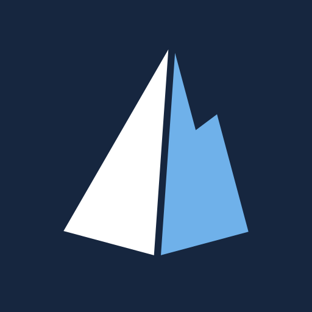

# Logo

The mark is "Sun and shade": one summit seen in 3D, its sunny side lit and its north face in shade. *Cima* is Italian for summit. It says what the app shows, terrain in sun and shade with the snow on it, and it needs no snow to make sense, so it works in summer too. Chosen in issue #103 over the earlier "Depth bands" icon.

## Construction

Two faces split by a ridge, on a 256 grid:

- **Sun side** at 60°, gentler than the **north face** at 75°: north faces in the Alps are the steep ones, cut by glaciers.
- A **shoulder** on the north face, a small second summit, so the shape reads as a mountain and not a pyramid.
- Both feet at 15°, meeting at a front corner below the summit, which gives the 3D view.
- The **ridge** leans 4° from vertical, so both faces have the same area. That keeps the mark readable at 16 px and in one colour.
- A **gap** of 2% of the canvas between the faces, cut for real, so the one-colour version keeps the two faces apart.

The mark sits inside the central circle of 80% of the canvas, so home screen masks and round avatars never cut it.

## Colours

| | Dark background | Light background |
| --- | --- | --- |
| Sun side | `#ffffff` | `#6fb1ea` |
| North face | `#6fb1ea` | `#2563c9` (the app's accent) |
| Tile | `#16263f` navy | none |

`#6fb1ea` is the map's 5–20 cm snow colour. The lit face is always the lighter one. One colour: both faces in the same colour, the gap shows the background.

## Wordmark

"Cima Map" in Barlow Bold, the app's typeface, with letter spacing −1%, turned into outlines. The mark stands to the left, as tall as the line from the bottom of the letters to a little above the capitals.

## Files

| File | Use |
| --- | --- |
| `web/public/icons/icon.svg` | The app icon (navy tile, full bleed). `node scripts/icons.mjs` renders the favicon, home screen icons and the avatar from it |
| `logo/cima-avatar-1080.png` | Instagram, TikTok and YouTube avatar |
| `logo/cima-mark.svg`, `-dark.svg`, `-black.svg` | The mark alone for light backgrounds, dark backgrounds, one colour |
| `logo/cima-lockup.svg`, `-dark.svg`, `-black.svg` | Mark and name, same three versions |

In the app the icon appears in the sidebar header, the phone's name pill and next to the version in About; the link preview card uses it too.

## Do and don't

- Keep the gap; do not join the faces or outline them.
- Keep the sunny face lighter than the north face; do not swap them or add a third colour.
- Do not stretch, rotate or add shadows or gradients.
- Below 24 px use the icon on its tile, not the bare mark.
