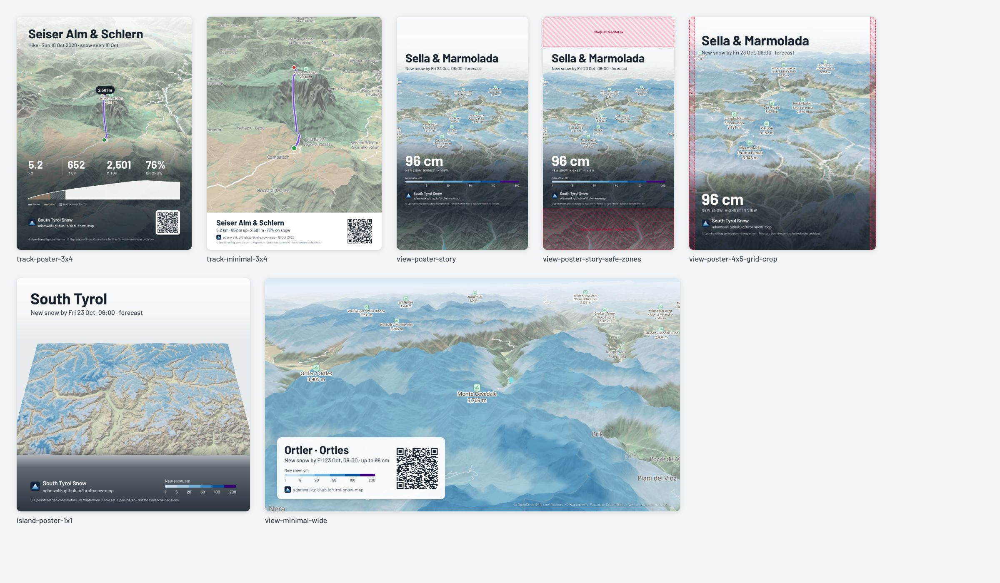
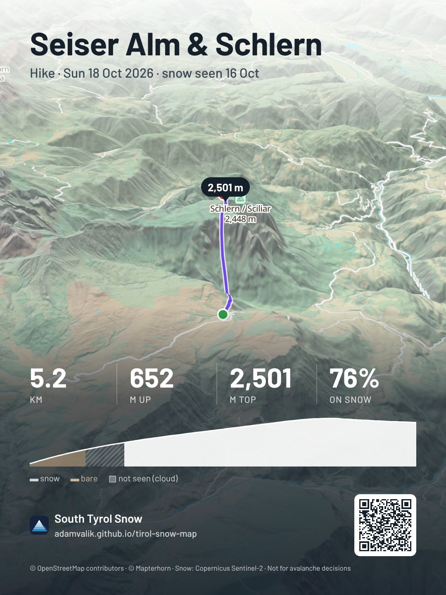
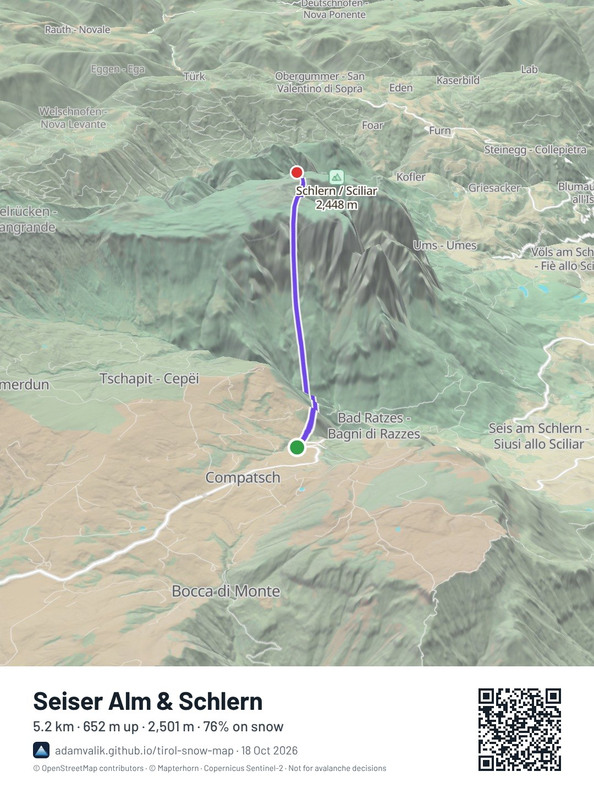
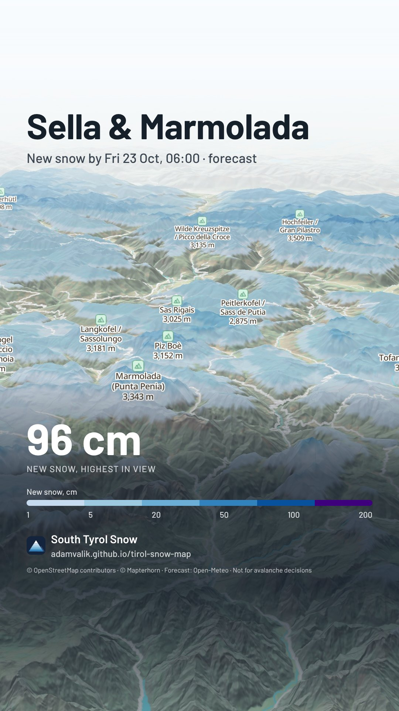
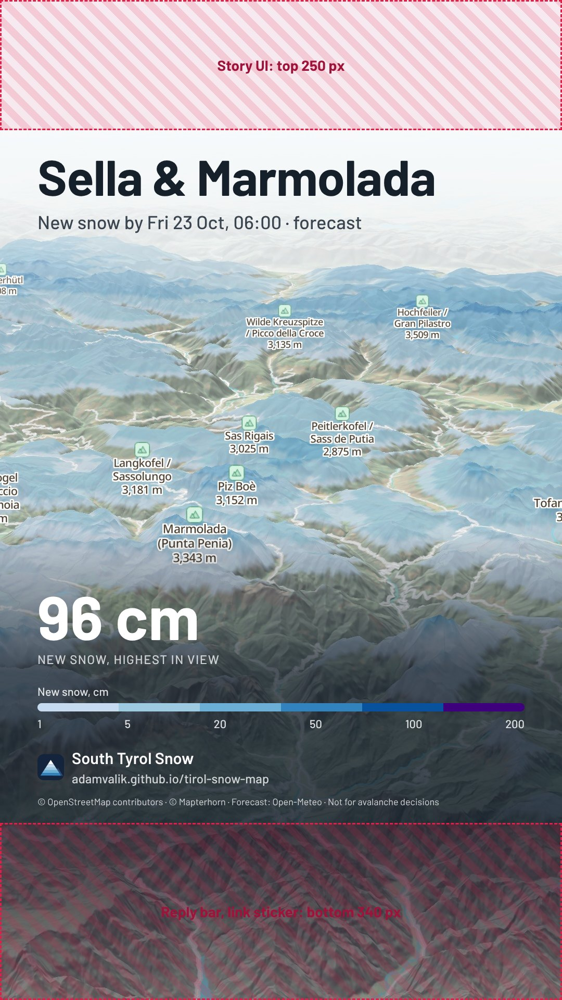
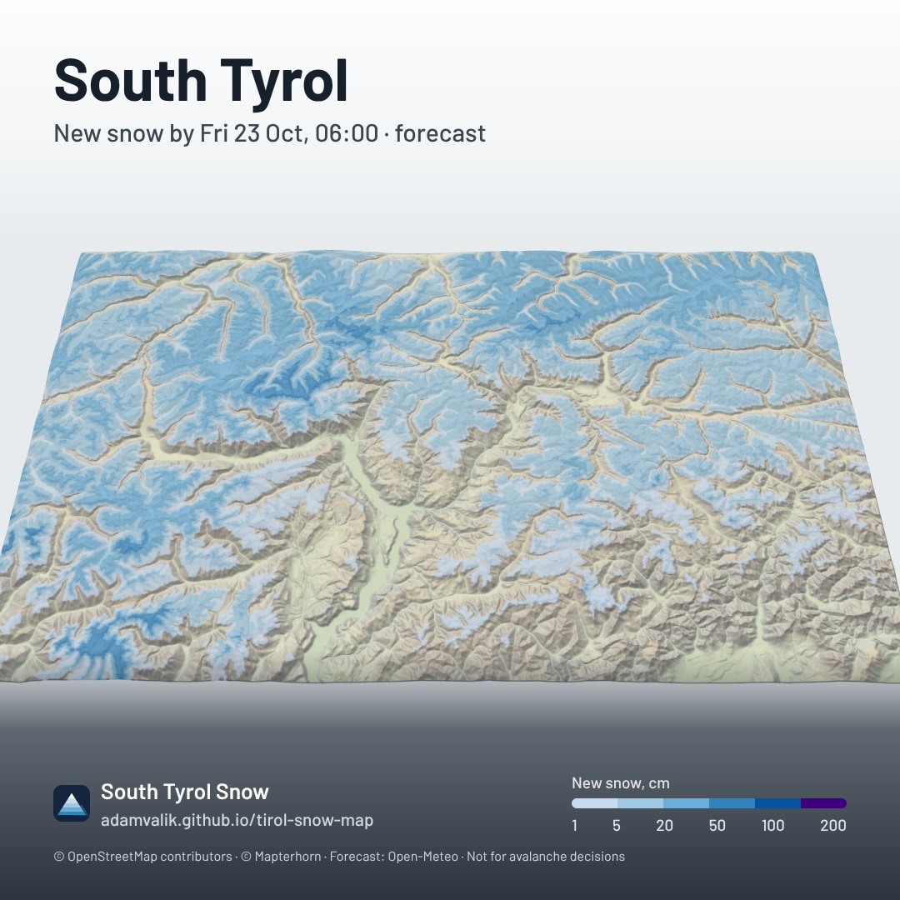
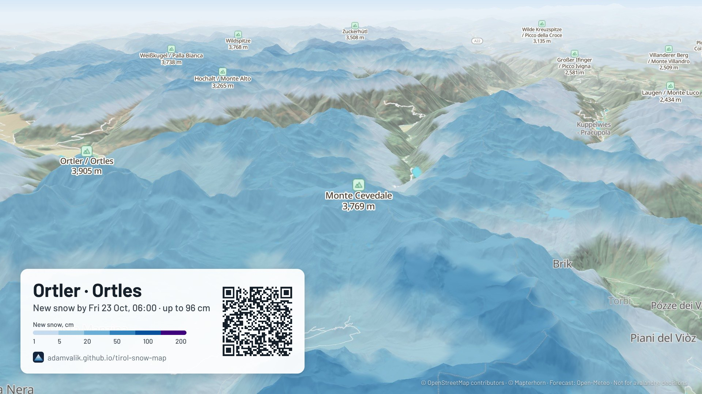

# Share picture – concept

Nov 3, 2026, reworked Nov 13 after mock-ups and a capture spike · Part of the [roadmap](roadmap.md), section 6

## What changed since the first design (Nov 3)

The first design is still the base. Working it through with real captures changed these points:

| Topic | Nov 3 | Now | Why |
| --- | --- | --- | --- |
| Main use | The current view | **Your track first**, the view second | The GPX track is built (release plan, 4). "After a tour, into Strava" is the case the picture exists for |
| Rendering | A second, hidden MapLibre map | **The visible map, resized behind the sheet** | Spike (below): sharp at every size, every layer comes along, no second WebGL context, no tile refetch |
| Default format | 4:5, 1080 × 1350 | **3:4, 1080 × 1440** | Instagram's feed and profile grid are 3:4 since 2025; a 4:5 picture loses 34 px on each side in the grid |
| Frame styles | Minimal or Poster, light and dark picked automatically | **One frame per format, no style picker**: Poster for portrait, story and square, a Minimal card for wide | Mock-ups below. Fewer choices; a light sky band and a dark scrim are always readable, so no brightness detection |
| QR code | Always, on by default | **Off by default except on Wide**, and a shorter link | A QR on a phone screen can rarely be scanned; the link is copied at share time instead |
| Labels in the picture | As on the map | **Summits only** | Town, road and water names through the frame are noise |
| Attribution | OSM, Mapterhorn, Copernicus | **Plus Open-Meteo (CC BY 4.0) and the station sources**, built from the layers shown | Every source in the picture needs credit |
| New | | Tour date from the GPX file, "hide start and end", picture links, the elevation profile with snow along it | Below |

## Goal

One tap turns a tour or a view into a picture that looks good as a Strava activity photo, an Instagram post or story, or a chat message, and that brings people back: the address is on it, and the link to the same view is copied when you share.

**Success looks like:** back from a tour, you load the GPX file, tap the camera, and the track on the snow is in the Strava activity in under 30 seconds. A friend who sees it knows the place, the numbers and the snow on that day, and finds the app from the address on it.

## Mock-ups

Rendered by [`scripts/share-mockups.mjs`](../scripts/share-mockups.mjs) from the built app with the fixture data (October 2026, so little snow; the views use the forecast's new snow). The map parts are real captures made as the app would make them, the frames are HTML with the app's font. The snow along the track is illustrative: the fixtures have no satellite day.

| Track · Poster · 3:4 (recommended) | Track · Minimal · 3:4 |
| --- | --- |
|  |  |

| View · Poster · 9:16 story | Same, Instagram's covered zones marked |
| --- | --- |
|  |  |

| Island · Poster · 1:1 | View · Minimal card · 16:9, with QR |
| --- | --- |
|  |  |

[`view-poster-4x5-grid-crop.jpg`](share-snapshot/view-poster-4x5-grid-crop.jpg) shows the strips the 3:4 grid cuts from a 4:5 picture.

What the mock-ups taught:

- **Poster beats Minimal.** The white bar takes a sixth of the picture and makes it look like an app screenshot. The poster keeps the map edge to edge and reads at thumbnail size: the title in the sky, the numbers big on the scrim. The Minimal look is still right for Wide, as a floating card, because a 16:9 picture is looked at on a large screen.
- **The camera depends on the frame.** The track has to sit in the space the frame leaves free (between the title and the numbers), so the frame layout gives the camera its padding. With the Minimal bar the camera comes closer.
- **The elevation profile with the snow along it is the one thing no other app shows.** It gets a row of its own on track pictures.
- **The island is the strongest "South Tyrol" picture.** A block on a plain floor, like a printed relief. It is the natural Square default when the whole area is in view, and a good base for the link preview image.
- **Bilingual labels are long** ("Wilde Kreuzspitze / Picco della Croce 3,135 m"). Summits only keeps them few. The title uses one name, editable.

## Two kinds of picture

**Track picture** (when a GPX track is loaded; the default then):

- **Camera**: fits the track in the frame's free box, tilted 58°, looking along it (the start-to-end bearing `viewBearing` already gives). One "Adjust view" step lets you rotate or zoom before export; the frame then keeps your camera.
- **Title**: the track name, editable. **Subline**: activity type and date from the file ("Hike · Sun 18 Oct 2026"), then the date of the snow shown ("snow seen 16 Oct").
- **Numbers**: distance, climb, highest point and share on snow, from `ShownTrack.stats` and `gpxSnow()`. Without heights: distance and share on snow only.
- **Profile**: `ShownTrack.profile` with `gpxSnow().points`: white where the satellite saw snow, earth where bare, hatched where it could not see. A legend line under it.
- **Highest point pin** with its height, so the eye finds the summit.
- **Snow on the day of the tour**: GPX files from watches carry times. Read the first `<time>` (a small addition to `parseGpx`), and if that day is in the 14-day timeline, the sheet offers "Show the snow on the day of the tour" and moves the day slider there. Without it, the picture says which day the snow is from, never implying it is the tour day.
- **Hide start and end**: a toggle that trims the first and last 300 m and drops the end dots, as Strava's privacy zones do for a track that starts at home. Off by default (most tours start at a car park), always visible in the sheet.
- The track stays in the browser. The copied link and the QR open the view without it; the sheet says so.

**View picture** (no track):

- **Camera**: the current one. Same ground width as on screen (zoom changes by log2 of export width over screen width), so what you framed stays framed.
- **Title**: nearest major summit or place to the centre (from `summits.json`, then basemap places), editable; "South Tyrol" when the island is in view.
- **Subline**: what and when: "New snow by Fri 23 Oct, 06:00 · forecast", "Snow seen from space, 16 Oct", "Snow depth estimate, 20 Oct".
- **One hero number**, picked by the top snow layer that is on: forecast → most new snow in view; depth estimate → depth at the selected point, else the median in view; snow from space → share of the view under snow; stations only → deepest station in view. Nothing when no snow layer is on.
- **Legend** of that layer only, compact.
- The selected point's pin is a DOM marker, so it is not in the captured map: the frame draws it at the projected position.

## Formats

| Preset | Size | For | Frame | QR default |
| --- | --- | --- | --- | --- |
| **Portrait 3:4** (default) | 1080 × 1440 | Strava activity photo, Instagram feed, WhatsApp | Poster | Off |
| Story 9:16 | 1080 × 1920 | Instagram and WhatsApp stories | Poster, everything inside 250 px from the top and 340 px from the bottom | Off: use the link sticker |
| Square 1:1 | 1080 × 1080 | Anywhere; the island | Poster | Off |
| Wide 16:9 | 1920 × 1080 | Chats on a laptop, slides, wallpaper, the link preview | Minimal card | On |

Strava's own crop for feed photos is not documented. Upload a 3:4 and a 1:1 mock-up to a test activity on both phones before fixing the layout; if the feed crops 3:4, move the numbers up into the centre square.

## The frame

Sizes in pixels of a 1080-wide picture; Wide scales by height.

- **Sky band** at the top: white, 90 % to 0 over about 330 px. At the usual pitch the top of the picture is pale haze, so dark text works; at low pitch the band itself carries it. Title Barlow 700 at 78 px (96 px on stories), subline Barlow 500 at 32 px in `--ink-2`.
- **Scrim** at the bottom: ink `#0c1622`, 0 → 86 % over 470–700 px. Numbers Barlow 700 at 66 px with small uppercase labels; one hero number at 92–118 px.
- **Brand row**: the app icon, the app name, the address. One component reading `APP_NAME` and `ADDRESS` constants, so the name decision (roadmap 5) changes one line.
- **Credits**, 16–18 px at 78 % white: one line built from the layers in the picture, plus "Not for avalanche decisions" whenever a snow layer is shown.
- Margins 72 px left and right, so the 3:4 grid crop and rounded corners in apps never cut text.
- No light or dark variants and no brightness detection: the two bands always give the contrast.

## The link and the QR code

The view link carries every layer and the exaggeration, which makes it long. Measured with the real encoder:

| Link | Characters | QR at level M |
| --- | --- | --- |
| Today's `toHash` for a typical view | 144 | version 8, 49 × 49 modules |
| **Picture link**: only what differs from the defaults (`x` left out at 1.5, default layers left out) plus `&s` | ~103 | version 6, 41 × 41 |
| The same on a short domain | ~72 | version 5, 37 × 37 |

For a code to survive Strava and WhatsApp compression and be scanned off another screen it needs about 3.5 px per module: about 150 px for version 6, a seventh of the picture's width. That is fine in the Wide card and too much for a story. And most people see the picture on the phone they would scan with. So:

- **On share, the picture link is copied** and the toast says "Picture shared. Link copied: paste it in the activity description or as a link sticker." This is the real way back to the app on Strava and Instagram, which usually ignore a `url` shared along with a file.
- **QR on by default only on Wide**, a toggle on the others.
- **Picture links** need `parseHash` to accept a short layer form relative to the defaults. Old links keep working. `&s` replaces `ref=snap` and lets GoatCounter count arrivals from pictures later.
- Encoder: [`uqr`](https://www.npmjs.com/package/uqr) (MIT, about 4 KB gzipped, no dependencies), loaded with the sheet. Not yet in `package.json`.

## The sheet

1. **Camera button** in the panel head next to the share button, and "Picture of this track" in the track panel. On phones the map button gets a second action.
2. A sheet over the map with: a **live preview** (the real picture, scaled), **format** chips (3:4, Story, Square, Wide), **title** text field, toggles for **numbers**, **QR**, and for tracks **hide start and end** and **snow on the tour day** (when there is a time), and **Adjust view** (closes the sheet, the map shows the frame's outline, "Done" returns).
3. **Share** on phones, **Download** on desktop, **Copy image** where the Clipboard API takes images.

Rendering starts as soon as the sheet opens and again after each change (debounced). The Share button is enabled when the picture is ready, and its click calls `navigator.share({ files: [jpeg], title })` before anything else is awaited: browsers allow share only within a few seconds of the tap ("transient activation"), and a render can take longer than that. Clipboard write of the link goes right before the share call; check on iOS that both are allowed from one tap, otherwise offer "Copy link" in the sheet after sharing.

File: JPEG at quality 0.9 (the mock-ups are 150–370 KB; a PNG of terrain is several MB and every platform recompresses anyway), named `snowmap-seiser-alm-schlern-2026-10-18.jpg`.

## How the capture works (spiked Nov 13)

The spike is `scripts/share-mockups.mjs`. It runs the steps below in headless Chromium on the built app:

1. Cover the map with the sheet. Set the map container to `export size / 2` CSS pixels (`position: fixed`) and `map.setPixelRatio(2)`, then `map.resize()`.
2. Adjust the zoom for the size, and lower `minZoom` for the capture: a 540 px wide export of the whole island needs zoom 7, under the app's 7.5.
3. Picture-only styling: hide `gpx-label` (the frame shows the name) and the basemap's label layers, keep the summits; restore afterwards.
4. Track pictures: `fitBounds` with the frame's padding, the track's bearing and pitch 58.
5. Wait for `idle`, then `triggerRepaint()` and in the next `render` event `drawImage` the WebGL canvas into a 2D canvas. Reading inside the render event works without `preserveDrawingBuffer`.
6. Restore size, pixel ratio, min zoom, layers and camera.

Results: the canvas came out at exactly 1080 × 1440, 1080 × 1920, 1080 × 1080 and 1920 × 1080, sharp, with terrain, hillshade, relief, forecast, the island cut and the GPX line. In software WebGL (CI-like) a capture took 4–27 s; a phone GPU should be far quicker, which the phone check has to show. Terrain tiles at the new size mostly come from the browser cache.

Not seen in the spike, to check while building:

- **iOS Safari**: the read in the render event, and memory at 1080 × 1920 × ratio 2 (fall back to ratio 1.5, then to 1:1 at 810 px if the context is lost).
- **Sun and shade**: cast shadows are a canvas source over the snow grid, and the 3D cabins are extrusions, so both should follow the resize. Neither is a custom layer any more, so the Nov 3 worry about re-adding custom layers is gone.
- **Live location dot** (when built): a DOM marker, so it is left out. Keep it out.
- The forecast animation must be paused during a capture.

Composition in the app: a 2D canvas, the captured map, then the frame drawn with canvas text in Barlow after `document.fonts.ready`. The mock-ups used HTML for speed; the layout numbers above carry over. Keep the layout a pure function (texts, format → boxes and font sizes) so it can be unit-tested and reused for the link preview and a later orbit video.

## Link preview

Unchanged in intent (release plan, 5): `og:` and `twitter:` tags, and an `og.png` of 1200 × 630 made in the deploy workflow with Playwright. New: make it with the same frame as the Wide picture, from the island with today's snow and the date. The mock-up script already captures and frames that way, so the deploy step can grow from it.

## Analytics

`share-picture/<format>` with `track` or `view`, once per share. Whether the QR is on, as a second event, only if the QR question is still open after testing.

## Acceptance

- 3:4 export on a mid-range phone in under 5 seconds, sharp at 1080 px, no UI in the map area, and the visible map back as it was.
- Shares straight into the Strava and Instagram apps from iOS Safari and Android Chrome (manual check, both), and the link is in the clipboard afterwards.
- A track picture shows the four numbers and the profile with snow, and the camera keeps the whole track clear of the title and the numbers.
- A picture link opens the same camera, layers and day; old links still open.
- Credits for every source in the picture.
- Tests: the layout function (texts fit at every format, numbers chosen by layer, credits by layer), the picture link round trip, the GPX `<time>` read; a smoke test step that exports every format without console errors and checks the size.

## Decisions for you

1. **Frame**: Poster for 3:4, story and square, Minimal card for Wide, no picker (recommended), or a picker between both?
2. **QR**: only on Wide by default (recommended), or on everywhere as first planned?
3. **Hide start and end**: off by default (recommended) or on?
4. **Story safe zones**: frame inside 250 px top / 340 px bottom (recommended), or full bleed and accept the reply bar over the credits?
5. **Name**: the picture prints the name and the address on every share. Settle it (roadmap 5) before pictures go to testers, or ship with "South Tyrol Snow" and the `github.io` address?
